# MODUS — Modelo de datos y trabajo con Supabase

Actualización 2026-11-09 · Modelo implementado parcialmente en Supabase local para revisión; no aplicado al remoto.

Este documento reúne el contexto, el Mermaid completo y las decisiones acordadas para la base compartida de MODUS. «Consolidado» significa que incorpora las decisiones de esta revisión; no implica que se hayan creado tablas ni que autorice aplicar SQL. El responsable revisará este documento y luego solicitará una revisión con agentes antes de comenzar la implementación.

## 1. Contexto y responsabilidades

MODUS es un proyecto universitario para adolescentes cuyo segmento principal es 13–17 años. Integra Prevención/concientización, Detección/orientación no diagnóstica y Comunidad/apoyo entre pares. No realiza diagnósticos ni tratamientos. La opción de onboarding «18 años o más» permite continuar normalmente; no concede un rol especial.

El responsable de Detección y su Driver se encargarán del modelo y de preparar la base compartida de Supabase para los tres ejes. Los demás integrantes consumirán los contratos y permisos acordados para sus funcionalidades. Los cambios que afecten a varios ejes se comunicarán y coordinarán antes de integrarlos.

La arquitectura se conserva: React utiliza Supabase Auth y la Data API con su sesión; PostgreSQL protege integridad y autorización mediante restricciones, transacciones y RLS. Express se incorpora cuando exista una necesidad concreta de servidor, no como intermediario obligatorio. La referencia arquitectónica es [backend.md](backend.md).

### Fuentes y estado comprobado

- Constitución y reglas compartidas: [CONSTITUTION.md](CONSTITUTION.md), [AGENTS.md](../AGENTS.md) y guías técnicas.
- [Trello](https://trello.com/b/nMHsAZXQ/proyecto-tratar-ludopatia): exportación pública consultada el 2026-11-09, con 8 RF de Prevención, 13 de Detección y 12 de Comunidad. El conector rechazó el acceso; la lectura pública sí fue posible.
- Código local revisado en `develop`: biblioteca `supabase-js`, variables locales y cliente en `frontend/src/lib/supabase.js` preparados; ninguna solicitud desde ese cliente se verificó en esta revisión. Registro, inicio de sesión y protección real de rutas siguen pendientes.
- La última consulta del proyecto remoto devolvió `public` sin tablas; esto no prueba que otros esquemas estén vacíos. Hay historial remoto existente pendiente de reconciliación, detallado en la sección 9. Las tablas nuevas se crearon únicamente en la instancia local.
- Prevención usa contenido en archivos JavaScript. Comunidad y Perfil contienen interacciones y ejemplos visuales locales; no son evidencia de persistencia o de requisitos adicionales.

No se copian credenciales a este documento. `.env` queda local; `.env.example` contiene nombres de variables sin valores privados. Las skills y perfiles personales ignorados no forman parte de la documentación compartida del equipo.

## 2. Decisiones acordadas

1. Se elimina `preferencias_usuario` y también el control de ocultar el resumen de Home. El resumen sigue siendo accesible únicamente por su dueño. Esto cambia expresamente esa parte de [RF-DO-13](https://trello.com/c/vRsSSxAH); Trello no fue modificado y deberá sincronizarse cuando se autorice su actualización.
2. El día funcional es el de `America/Argentina/Cordoba`, de una medianoche a la siguiente, calculado por PostgreSQL o una operación confiable de servidor. Se utiliza el mismo criterio en registros, historial, calendario y ambas rachas; no depende del reloj del navegador.
3. Mi actividad admite una entrada por usuario y fecha, actualizable solo durante ese día. No se habilita eliminarla ni crear o modificar entradas de fechas cerradas.
4. El dinero se declara en pesos argentinos, con hasta dos decimales. El tiempo admite decimales en minutos u horas; la cantidad de apuestas es entera. Las cantidades son opcionales, finitas y no negativas. Ausencia de dato no equivale a cero.
5. Las respuestas omitidas del onboarding permanecen sin dato. Al completarlo u omitirlo se conserva lo proporcionado y se cierra definitivamente su edición.
6. Al eliminar una publicación o comentario se retiran su texto e identidad visible y se conserva un marcador con las respuestas ajenas. No se conserva una copia oculta del texto retirado.
7. Cualquier integrante aceptado de un tablero puede invitar a sus propios compañeros con vínculo aceptado. Las publicaciones internas se habilitan a partir de dos integrantes aceptados. Una invitación pendiente no da acceso al contenido interno.
8. Un día de participación válidamente acreditado se conserva aunque se retire después el contenido que lo originó. No se conserva ese texto para mantener la racha.
9. Desmarcar una medida retira las publicaciones de los logros que dependían de esa medida, conservando las respuestas mediante el marcador. Volver a marcar no republica nada automáticamente.
10. El contenido editorial de Prevención continúa en archivos del proyecto. No se crean tablas editoriales en este modelo. Una necesidad futura se incorpora mediante nuevas migraciones, sin tablas ni campos vacíos «por si acaso».

## 3. Mermaid completo

El modelo contiene 21 tablas de aplicación y una referencia a `auth.users`, administrada por Supabase. Las migraciones locales preparan estas estructuras; la implementación de sus operaciones y la verificación aún son parciales.

Los identificadores independientes son `bigint` con identidad; las referencias a cuentas son `uuid`. `PK` identifica una fila, `FK` relaciona tablas y `UK` indica unicidad. En claves compuestas, los campos marcados `PK` forman juntos una sola clave. La obligatoriedad de cada campo se explica en las reglas posteriores: Mermaid no expresa todas las restricciones SQL.

En el diagrama, `auth_users` representa `auth.users`. `autorias_publicaciones`, `autorias_comentarios` y `origenes_logros_medidas` estarán en un esquema `private` no expuesto por la Data API; las demás tablas se prevén en `public` con acceso explícito y RLS. Que una tabla esté en `public` no significa que sus datos sean públicos.

```mermaid
erDiagram
    auth_users ||--o| perfiles : tiene
    auth_users ||--o| onboarding : finaliza
    auth_users ||--o{ registros_actividad : registra
    registros_actividad ||--o{ registro_conductas : incluye
    conductas ||--o{ registro_conductas : clasifica

    recursos ||--o{ medidas_proteccion : permite_realizar
    medidas_proteccion ||--o{ medidas_usuario : tiene_estados
    auth_users ||--o{ medidas_usuario : declara

    auth_users ||--o{ vinculos : solicita
    auth_users ||--o{ vinculos : recibe
    auth_users ||--o{ tableros_apoyo : crea
    tableros_apoyo ||--o{ participantes_tablero : incluye
    auth_users ||--o{ participantes_tablero : participa
    auth_users o|--o{ participantes_tablero : invita

    tableros_apoyo o|--o{ publicaciones : contiene
    etiquetas_comunidad o|--o{ publicaciones : clasifica
    perfiles o|--o{ publicaciones : identidad_visible
    publicaciones ||--|| autorias_publicaciones : tiene_autoria_privada
    auth_users ||--o{ autorias_publicaciones : es_autor

    publicaciones ||--o{ comentarios : recibe
    comentarios o|--o{ comentarios : recibe_respuestas
    perfiles o|--o{ comentarios : identidad_visible
    comentarios ||--|| autorias_comentarios : tiene_autoria_privada
    auth_users ||--o{ autorias_comentarios : es_autor
    publicaciones ||--o{ reacciones : recibe
    auth_users ||--o{ reacciones : realiza

    publicaciones ||--o| logros_compartidos : puede_contener
    logros_compartidos ||--o| origenes_logros_medidas : tiene_origen_privado
    medidas_usuario ||--o{ origenes_logros_medidas : permite_retirar

    auth_users ||--o{ participacion_diaria : acredita
    tableros_apoyo ||--o{ participacion_tablero_diaria : acredita

    auth_users {
        uuid id PK
    }
    perfiles {
        uuid usuario_id PK, FK
        text username UK
        text avatar_path
        timestamptz creado_en
    }
    onboarding {
        uuid usuario_id PK, FK
        text estado
        text rango_edad
        boolean participo_en_apuestas
        text frecuencia_inicial
        text percepcion_personal
        text motivo_ingreso
        timestamptz finalizado_en
    }
    registros_actividad {
        bigint id PK
        uuid usuario_id FK
        date fecha
        boolean aposto
        boolean tuvo_ganas
        numeric tiempo_valor
        text tiempo_unidad
        integer cantidad_apuestas
        numeric dinero_apostado
        numeric dinero_perdido
        text observacion
        timestamptz creado_en
        timestamptz actualizado_en
    }
    conductas {
        text codigo PK
        text nombre
    }
    registro_conductas {
        bigint registro_id PK, FK
        text conducta_codigo PK, FK
    }
    recursos {
        bigint id PK
        text nombre
        text utilidad
        text imagen_o_icono
        text enlace
        text instrucciones
        text compatibilidad
        text categoria_escudo
        text alcance_territorial
        text fuente_verificacion
        timestamptz verificado_en
        boolean publicado
    }
    medidas_proteccion {
        bigint id PK
        bigint recurso_id FK
        text descripcion
    }
    medidas_usuario {
        uuid usuario_id PK, FK
        bigint medida_id PK, FK
        boolean realizada
        timestamptz actualizado_en
    }
    vinculos {
        bigint id PK
        uuid solicitante_id FK
        uuid destinatario_id FK
        text estado
        timestamptz solicitado_en
        timestamptz respondido_en
    }
    tableros_apoyo {
        bigint id PK
        uuid creador_id FK
        text nombre
        timestamptz creado_en
    }
    participantes_tablero {
        bigint tablero_id PK, FK
        uuid usuario_id PK, FK
        uuid invitado_por FK
        text estado
        timestamptz invitado_en
        timestamptz respondido_en
    }
    etiquetas_comunidad {
        text codigo PK
        text nombre
    }
    publicaciones {
        bigint id PK
        bigint tablero_id FK
        text etiqueta_codigo FK
        uuid perfil_visible_id FK
        text tipo
        text titulo
        text contenido
        timestamptz creado_en
        timestamptz eliminado_en
    }
    autorias_publicaciones {
        bigint publicacion_id PK, FK
        uuid usuario_id FK
    }
    comentarios {
        bigint id PK
        bigint publicacion_id FK
        bigint respuesta_a_id FK
        uuid perfil_visible_id FK
        text contenido
        timestamptz creado_en
        timestamptz eliminado_en
    }
    autorias_comentarios {
        bigint comentario_id PK, FK
        uuid usuario_id FK
    }
    reacciones {
        bigint publicacion_id PK, FK
        uuid usuario_id PK, FK
    }
    logros_compartidos {
        bigint publicacion_id PK, FK
        text logro_codigo
        text regla_version
        date fecha_del_hecho
    }
    origenes_logros_medidas {
        bigint publicacion_id PK, FK
        uuid usuario_id FK
        bigint medida_id FK
    }
    participacion_diaria {
        uuid usuario_id PK, FK
        date fecha PK
        text primera_accion_valida
        timestamptz acreditado_en
    }
    participacion_tablero_diaria {
        bigint tablero_id PK, FK
        date fecha PK
        text primera_accion_valida
        timestamptz acreditado_en
    }
```



## 4. Responsabilidad de cada tabla y sus relaciones

### Cuenta y onboarding

- **`auth.users` — externa al modelo de aplicación:** Supabase administra identidad, credenciales y sesiones. No se replican contraseñas, tokens o una autenticación propia.
- **`perfiles`:** username único sin distinguir mayúsculas y minúsculas, después de recortar espacios, y ruta opcional de avatar. Su PK es también FK a `auth.users.id`, de modo que una cuenta tiene como máximo un perfil. Solo esos datos de identidad pueden exponerse a otros participantes autorizados. No incluye respuestas, edad, preferencias privadas, biografía o portada no aprobadas. La imagen predeterminada se resuelve en la interfaz; un avatar subido, cuando se implemente, será un objeto de Storage con permisos propios.
- **`onboarding`:** una finalización por cuenta, con estado `completado` u `omitido`, fecha de cierre y las cinco respuestas opcionales. No existe fila final mientras el recorrido continúa localmente. La operación de finalización conserva las respuestas proporcionadas y rechaza nuevas finalizaciones o ediciones. Las opciones se validan contra el catálogo de preguntas vigente; `13-14`, `15-17` y `18-plus` son los rangos actuales. No se guarda fecha de nacimiento exacta ni se deriva un rol, diagnóstico o registro diario.

### Actividad personal

- **`registros_actividad`:** hechos declarados de un día, con `UNIQUE (usuario_id, fecha)`. `aposto` es obligatorio; ganas, cantidades y observación son opcionales. Dinero apostado y perdido permanecen separados. Se conserva el tiempo con su unidad y se normaliza solo para calcular. Un día sin fila es un día sin información.
- **`conductas`:** catálogo de códigos estables para las situaciones aprobadas en RF-DO-02. Permite mejorar el texto visible sin modificar las asociaciones históricas. No contiene puntuaciones, umbrales o clasificaciones clínicas.
- **`registro_conductas`:** tabla intermedia entre registros y conductas. Si el registro 42 incluye dos conductas, hay una fila del registro y dos asociaciones con códigos distintos. Su PK compuesta impide repetir una conducta dentro del mismo registro. No seleccionada significa no informada mediante esa selección; no constituye una negación clínica. Los códigos no se eliminan físicamente mientras estén referenciados.

Los tres objetos se guardan o actualizan de forma coherente en una transacción. Las asociaciones también quedan cerradas al terminar el día; proteger solo la fila principal sería insuficiente.

### Recursos y medidas

- **`recursos`:** catálogo único para Prevención y Escudo: utilidad, instrucciones de uso, enlace, imagen o icono, compatibilidad y alcance territorial cuando correspondan. Fuente y fecha de verificación respaldan la curación; `publicado` controla qué material está disponible. Publicarlo requiere revisión del equipo, no una afirmación del usuario. `categoria_escudo` es opcional: `acceso`, `estimulos` o `apoyo`. Un recurso informativo puede mostrarse en Escudo sin ser una acción para marcar.
- **`medidas_proteccion`:** acciones concretas relacionadas con un recurso. Una guía puede tener varias medidas; un recurso informativo puede no tener ninguna. La descripción identifica la acción, y las instrucciones generales permanecen en el recurso. No se duplican categorías o proveedores en cada estado personal.
- **`medidas_usuario`:** estado actual declarado por cuenta y medida. Su PK `(usuario_id, medida_id)` evita duplicados. Marcar y desmarcar actualiza la misma fila, que se conserva aunque el estado sea falso. No comprueba software externo, activa bloqueos ni publica por sí sola.

### Compañeros y tableros

- **`vinculos`:** relación entre solicitante y destinatario, con estado `pendiente`, `aceptado` o `rechazado`. La misma fila representa solicitud y resultado; no hay una segunda lista de amigos. Se impide vincularse consigo mismo y duplicar el par en orden inverso. Solo el destinatario responde una solicitud pendiente; los participantes de la relación son inmutables.
- **`tableros_apoyo`:** identidad, nombre y creador del espacio compartido. El creador se registra como integrante aceptado en la misma transacción de creación. El tablero puede existir mientras se organiza, pero no admite publicaciones hasta tener dos integrantes aceptados.
- **`participantes_tablero`:** invitación y resultado por cuenta y tablero, con estado `pendiente`, `aceptado` o `rechazado`. `invitado_por` es opcional únicamente para la incorporación inicial del creador. Los integrantes aceptados pueden invitar a sus compañeros vinculados; solo el invitado acepta o rechaza su invitación pendiente. El invitado recibe los datos mínimos para decidir, sin acceso al contenido interno. No se implementan expulsiones, roles administrativos adicionales o salidas de grupos por arrastre del modelo.

Una relación pendiente o rechazada no habilita acceso. La forma de reenviar solicitudes o invitaciones rechazadas se refinará al abordar esas historias; no se habilita una operación nueva en esta etapa ni se añade otra tabla para anticiparla.

### Publicaciones, comentarios y anonimato

- **`etiquetas_comunidad`:** códigos y nombres del catálogo temático. Se contempla una etiqueta principal por publicación general. No requiere una tabla intermedia mientras no se aprueben varias etiquetas simultáneas.
- **`publicaciones`:** texto y destino. `tablero_id IS NULL` identifica Comunidad general; una FK indica contenido interno. El destino queda fijado al crear y no puede cambiarse para hacer público un texto privado. Los tipos previstos son `texto`, `hilo` y `logro`; los hilos del equipo requieren autorización confiable. La publicación general vigente requiere título, contenido y etiqueta; la interna no exige título o etiqueta. `perfil_visible_id` corresponde al autor cuando elige identificarse y es nulo cuando elige anonimato. No hay adjuntos ni edición posterior.
- **`private.autorias_publicaciones`:** propietario real de cada publicación, incluso anónima. Se separa del contenido legible porque RLS filtra filas, no oculta automáticamente una columna de autor. Permite verificar propiedad sin entregar el vínculo interno a otros lectores. Publicación y autoría se crean atómicamente; no se permiten publicaciones huérfanas ni identidades visibles ajenas.
- **`comentarios`:** texto, publicación y respuesta opcional a otro comentario. La respuesta debe pertenecer a la misma publicación, mediante una FK compuesta u otra garantía equivalente en PostgreSQL; no basta con comprobarlo en React. Publicación, padre y autor son inmutables. No se permiten ciclos, respuestas a publicaciones ajenas al tablero autorizado ni conversaciones privadas independientes.
- **`private.autorias_comentarios`:** propietario real de cada comentario, con las mismas garantías de anonimato y atomicidad. Permite eliminar contenido anónimo propio. El marcador de contenido eliminado puede conservar su autoría interna para gestionar propiedad, pero nunca mostrará identidad visible ni texto retirado.
- **`reacciones`:** una fila por usuario y publicación para la reacción de utilidad/apoyo. La PK compuesta evita votos repetidos. Se muestran conteos autorizados y, si corresponde, el estado propio; no se entrega indiscriminadamente la lista de personas que reaccionaron. No mantiene la racha grupal ni genera puntos competitivos.

Eliminar contenido marca `eliminado_en`, retira título/texto/identidad visible y los metadatos compartidos que puedan seguir revelando el contenido. Conserva el identificador, destino y relaciones mínimos para mostrar «contenido eliminado» y mantener respuestas. Los campos de contenido solo pueden quedar vacíos en ese estado y no pueden restaurarse mediante una edición. Las respuestas a comentarios se mantienen; no hay `CASCADE` que retire conversaciones ajenas por esta operación. No se habilitan nuevos comentarios o reacciones sobre marcadores eliminados; las respuestas existentes permanecen consultables según los permisos del destino.

### Logros compartidos y retirada

- **`logros_compartidos`:** metadatos del logro elegido, vinculados a una publicación existente. El texto elegido se guarda en `publicaciones.contenido`, sin otra copia del mismo texto. Código, versión de regla y fecha permiten identificar qué hecho se compartió. La operación calcula o valida el hecho desde datos propios y crea únicamente el contenido consentido. No incluye registro diario, nota privada ni respuestas del onboarding.
- **`private.origenes_logros_medidas`:** asociación mínima para los logros dependientes de una medida. Su PK/FK apunta a `logros_compartidos.publicacion_id`; su FK compuesta `(usuario_id, medida_id)` apunta a `medidas_usuario`. Verifica además que esa cuenta sea la autora real. Se mantiene privada: no es un enlace navegable al estado personal. No se crea una fila aquí para logros que no dependen de medidas.

Desmarcar una medida actualiza su estado y retira todas las publicaciones de logros que dependan de esa medida de la misma cuenta, tanto generales como de tableros. La retirada usa el mismo marcador de contenido eliminado, limpia el contenido del logro y conserva respuestas y participación ya acreditada. Se eliminan sus metadatos de logro y el origen privado asociado. Volver a marcar no restaura ni publica nada.

Compartir y desmarcar deben coordinarse sobre la misma fila de `medidas_usuario` en transacciones, con un bloqueo coherente, para impedir que una publicación basada en un estado anterior aparezca después de la desmarcación. No basta con ejecutar ambas solicitudes sucesivamente en React. La retirada derivada solo afecta las publicaciones vinculadas del propietario de la medida; no da permiso general para editar publicaciones ajenas.

Los catálogos concretos de logros y sus condiciones se refinarán en sus historias. No se inventan umbrales, metas, tests o resultados clínicos para completar tablas. No hay un motor genérico de reglas ni una tabla de logros adjudicados anticipadamente.

### Participación y rachas

- **`participacion_diaria`:** acredita como máximo un día por cuenta. Guarda la fecha, el código de la primera acción válida y el instante de acreditación. El hecho se escribe desde una operación verificada; el navegador no puede acreditarse fechas. Guardar Mi actividad es una acción aprobada; las acciones adicionales de otros módulos se concretarán con las funcionalidades disponibles, sin contar inicios de sesión.
- **`participacion_tablero_diaria`:** acredita como máximo un día por tablero. Solo cuentan las tres clases de RF-VP-12: crear una publicación interna, responder una publicación de otro integrante y compartir voluntariamente un logro compatible. Entrar, leer y reaccionar no cuentan. La autoría interna permite comprobar «otro integrante» también cuando existe anonimato.

Las filas diarias sobreviven al retiro de contenido porque acreditan un hecho ocurrido, sin conservar su texto ni una FK que lo haga necesario. Las rachas se calculan desde estas fechas; no son contadores editables por React. No representan días sin apostar. La racha grupal no exige participar a todos y no sustituye a la personal.

## 5. Integridad, tipos y seguridad

### Reglas generales

- Nombres en minúscula con guiones bajos; PK y FK con tipos compatibles. `bigint generated always as identity` para identificadores independientes, `uuid` para cuentas.
- Cantidades opcionales sin `DEFAULT 0`. Dinero `numeric` con validación explícita de finitud, no negatividad y hasta dos decimales, sin redondear silenciosamente una entrada inválida. Tiempo `numeric` finito no negativo, unidad `minutos` u `horas`, ambos presentes o ausentes juntos. Cantidad de apuestas `integer` no negativa. No se imponen máximos arbitrarios ni una relación automática entre dinero apostado y perdido.
- Cuando `aposto = false`, las cantidades exclusivas de apuestas quedan en `NULL`. Las conductas o consecuencias no se borran por inferencia de esa respuesta. Los datos omitidos no originan conclusiones.
- `timestamptz` para instantes; `date` para el día funcional. Fecha y marcas de tiempo se generan o validan desde PostgreSQL. Usuario, autor, destino y fecha no se aceptan como identidad por haber llegado del cliente.
- El cambio de día bloquea crear/actualizar registros anteriores y sus conductas. No se usa un `CHECK` dependiente del reloj como sustituto de comprobar cada escritura. No existe borrado de Mi actividad en las operaciones del MVP.
- PK compuestas evitan selecciones, reacciones, estados y participaciones duplicados. El registro diario agrega una restricción única por usuario/fecha. Los pares de compañeros se hacen únicos sin importar el sentido de la solicitud.
- Las operaciones de varias tablas se ejecutan en una transacción, incluidas las acreditaciones de participación correspondientes. Las transiciones de estado verifican el estado anterior y la cuenta autorizada para evitar dobles aceptaciones y carreras.
- Se indexan FK y columnas de permisos/consulta cuando no estén ya cubiertas por el prefijo de una PK o índice único: historial por usuario/fecha, publicaciones por destino/fecha, respuestas por publicación/padre y origen de logros por usuario/medida. No se crean índices duplicados ni optimizaciones avanzadas sin necesidad medida.
- No se adopta `ON DELETE CASCADE` indiscriminadamente. Retirar publicaciones es distinto de eliminar cuentas; el borrado de cuentas y su efecto en autorías, grupos y objetos de Storage requieren una historia y política explícitas antes de habilitar esa operación.

### Acceso efectivo

Todos los datos personales se protegen en la base, no solo con filtros de interfaz. Las tablas expuestas necesitan concesiones mínimas de acceso y RLS; son controles diferentes. Los catálogos publicados pueden leerse según el acceso del módulo y solo los modifica el equipo autorizado. No se considera autorizado a un usuario porque se haya escrito un rol en sus metadatos editables.

Onboarding, registros, selecciones y medidas solo son accesibles por su cuenta. Las vistas o funciones de Home e Historial respetan esos permisos. Los perfiles consultables incluyen únicamente la identidad permitida, nunca email, rango de edad o actividad privada.

Comunidad general se prevé para usuarios autenticados en el recorrido vigente; no se abre a visitantes por inferencia de un mockup. El contenido de tableros solo es accesible para integrantes aceptados. Una invitación concede acceso a sus datos mínimos, no al feed. Comentarios, reacciones, logros y sus conteos heredan la visibilidad de la publicación, incluida su eliminación.

Las tablas privadas no se consultan directamente desde React. Sus comprobaciones se resolverán con funciones acotadas y permisos explícitos; se evitará recursión de políticas. Si una función necesita `SECURITY DEFINER`, debe justificarlo, fijar un `search_path` seguro, cualificar referencias, comprobar identidad/permisos y limitar ejecución. No se usa para eludir una política incompleta. Las vistas consultables deben respetar al invocador cuando corresponda (`security_invoker`), sin revelar autorías privadas.

El contenido retirado no se devuelve en listados, búsquedas, resúmenes, tarjetas de logros, respuestas ni conteos de contenido vigente. La UI muestra un marcador genérico donde haga falta mantener una conversación. No se exponen identidades mediante consultas auxiliares de «mis publicaciones» o perfiles de intervenciones anónimas.

Home y Dashboard no necesitan tablas propias. Historial, calendario, totales, promedios, comparaciones y rachas se obtienen de sus fuentes. Los promedios usan únicamente datos declarados: 100, 200 y `NULL` producen promedio 150; cero declarado sí participa. La frecuencia inicial del onboarding no cuenta como actividad real.

## 6. Migraciones: qué son y quién hace qué

Una migración es un archivo SQL versionado que describe un cambio de la base: crear una tabla, agregar una restricción, definir políticas o modificar una función. El archivo no contiene una copia de toda la base ni los datos personales de los usuarios. Aplicarlo ejecuta esas instrucciones en una base concreta.

Git conserva los archivos; Supabase registra qué migraciones fueron aplicadas. Hacer `pull` descarga SQL, pero no lo ejecuta ni sincroniza los datos entre bases. El código de React no debe aplicar migraciones al iniciar la aplicación.

La estructura prevista, todavía sin crear en esta entrega, es:

```text
supabase/
  config.toml
  migrations/
    <marca_de_tiempo>_<descripcion>.sql
```

La CLI genera el nombre con `supabase migration new <descripcion>`. La versión 3.0.0 está fijada en la raíz como dependencia de desarrollo; la instalación y las pruebas realizadas son locales. Los archivos SQL llevarán comentarios en español sobre responsabilidad y decisiones no evidentes.

Cada migración debe dejar coherentes las tablas que incorpora, restricciones, permisos, RLS, funciones y los índices necesarios. La exposición por la Data API se concede deliberadamente; crear una tabla no prueba que pueda consultarse ni que sea segura. Los catálogos aprobados necesarios se incorporan de forma reproducible. Los datos ficticios de demostración se separan de la estructura y nunca se confunden con información de usuarios reales.

Una migración ya aplicada y compartida no se reescribe ni renombra para corregirla: se añade otra. Mientras un archivo no se haya aplicado ni compartido puede ajustarse durante el desarrollo local. El SQL del editor remoto no será una vía paralela para hacer cambios sin capturarlos en el historial. No se ejecutan resets remotos, reparaciones de historial o borrados para «sincronizar» sin diagnóstico y autorización.

### Preparación inicial, en una entrega posterior

1. Revisar el estado real del proyecto remoto, sus migraciones y cualquier objeto existente antes de establecer una línea de base local. No asumir base vacía por ver `public` vacío.
2. Preparar las herramientas y el entorno local con autorización; se recomienda que cada integrante tenga una base local para pruebas. La CLI y los requisitos de ejecución se verificarán antes de instalarlos.
3. Capturar o reconciliar el historial existente sin volver a aplicar cambios ya ejecutados y sin inventar marcas de migración. Revisar el resultado antes de compartirlo.
4. Incorporar la primera historia funcional y verificar que una base local preparada desde las migraciones reproduce el estado esperado.

### Flujo para los tres integrantes

El responsable de datos y su Driver preparan el modelo, migraciones y permisos compartidos; los compañeros coordinan necesidades y consumen los contratos de sus ejes. Cualquier cambio de estructura futura debe pasar por el mismo flujo.

1. Elegir y refinar una historia vinculada a RF; actualizar referencias de `develop` solo cuando se autorice la operación Git correspondiente.
2. Trabajar en una rama con una base local y datos de prueba ficticios. Preparar la migración junto con el código y verificaciones de esa historia.
3. Revisar efectos sobre los otros ejes, permisos y compatibilidad. Comprobar la secuencia con las migraciones recientes del equipo, no solo con la base personal que ya funcionaba.
4. Revisar y autorizar el commit y la integración según las convenciones del repositorio. Las migraciones se versionan; los secretos y las herramientas personales ignoradas no.
5. Coordinar una sola aplicación a la base compartida por vez, después de verificar el destino y el historial pendiente. Un merge o pull no despliega automáticamente SQL.
6. Los compañeros reciben los archivos desde `develop`, actualizan su base local siguiendo el procedimiento acordado y usan sus propias variables locales. Las cuentas de desarrollo de Supabase se invitan a la organización con permisos apropiados; no comparten la cuenta personal del responsable ni sus credenciales privilegiadas.

El despliegue compartido y sus comprobaciones quedan registrados en la historia: migraciones aplicadas, entorno, resultado y fallos, sin secretos. Los cambios incompatibles con un frontend existente deben coordinarse antes de aplicarlos; se favorecen ampliaciones compatibles y una retirada posterior cuando sea necesario. No se añade CI/CD automático en esta preparación.

## 7. Implementación incremental y contexto compartido

El modelo muestra todo el destino, pero se implementará mediante Vertical Slice Development: una capacidad pequeña con las partes de interfaz, datos y permisos que realmente necesite. No se construye primero toda la base, después todo Express y finalmente React. Tampoco es una arquitectura de carpetas.

La siguiente etapa acordada es: lectura del responsable → revisión acotada por un agente para detectar inconsistencias, sin correcciones automáticas → ajustes aprobados → historias nuevas derivadas de RF, sin duplicar Jira → refinamiento de una historia → implementación y verificación → explicación y revisión humana. Esta entrega no invoca agentes ni modifica Jira.

Las skills locales `backlog`, `story` y `pair`, adaptadas de hola-ai, acompañan ese flujo. La historia usa Como/Quiero/Para, Resumen, Contexto, criterios verificables y subtareas `FE · ...` o `BE · ...` solo cuando sean necesarias. No se fuerza Express ni una subtarea BE independiente cuando Supabase resuelve la operación.

Primero se preparará el entorno reproducible y luego cuenta/perfil/onboarding; después Mi actividad, consultas y cálculos, recursos/medidas e integraciones coordinadas. La preparación técnica es un habilitador identificado como tal; una UI local no se presenta como capacidad completa de extremo a extremo. No se crea ahora un backlog técnico detallado de todo el proyecto.

Este documento conserva el contexto de decisiones; Trello conserva RF y Jira las historias y resultados. Las futuras migraciones serán la referencia ejecutable de la estructura real. Al implementar una historia se actualizará este documento si cambian decisiones o estado, sin duplicar explicaciones extensas en otras guías. Las instrucciones personales de skills y agentes no se imponen al equipo.

### Comprobaciones que exigirán las historias

- Cuenta A no accede a onboarding, registros, selecciones ni medidas de B, aunque conozca identificadores.
- Onboarding completado u omitido no vuelve a finalizarse ni editarse; se conservan omisiones y se admite 18+.
- Dos guardados concurrentes del día dejan una sola entrada; pasado el cierre argentino, ni el registro ni sus asociaciones pueden modificarse.
- Vacío no es cero; tiempo en unidades distintas se compara correctamente y el dinero se mantiene en pesos, sin redondeo silencioso de entradas inválidas.
- Un lector no identifica al autor de una intervención anónima mediante su respuesta o relaciones auxiliares.
- Una invitación pendiente no permite consultar contenido del tablero; publicación interna exige membresía aceptada y al menos dos integrantes.
- Retirar contenido elimina texto e identidad visible, conserva respuestas y no resta días de participación.
- Desmarcar una medida retira sus logros publicados en cualquier destino; volver a marcar no los restaura. Se prueba también la carrera entre compartir y desmarcar.
- Inicio de sesión, lectura y reacción no mantienen la racha grupal; varias acciones válidas cuentan un solo día y las rachas usan el mismo día funcional.
- Las migraciones se prueban en una base local reproducible y con permisos de usuarios normales, no solo desde un editor con privilegios elevados.

Estas comprobaciones son criterios de revisión; su estado efectivo se indica en la sección 9. Los contratos concretos de RPC, límites técnicos de texto y reglas fundamentadas de logros/orientación se precisarán al refinar sus historias; no se habilitan capacidades nuevas desde esos pendientes.

## 8. Límites y diferencias documentales

No se añaden tablas para artículos, noticias, videos, reflexiones editoriales, Home, Dashboard, gráficos, diagnósticos, tratamientos, tests, ahorro, chat privado o funcionalidades no aprobadas. Prevención conserva sus archivos actuales; una futura persistencia editorial se añadirá cuando se acuerde con su responsable. Los contactos y recursos reales deben verificarse antes de publicarlos.

El código de Comunidad admite adjuntos, aunque RF-VP-02 los excluye. Perfil muestra ejemplos de tests, ahorro e insignias no aprobados. RF-VP-11 mantiene una referencia antigua a Detección en definición; se coordinará con RF-DO-09. Estas diferencias se informan para revisión y no autorizan modificar las páginas de compañeros.

El cliente preparado no implica que las pantallas estén conectadas ni que el entorno remoto haya recibido las migraciones.

## 9. Entorno local y verificaciones

La CLI Supabase 3.0.0 se instala con `npm ci` en la raíz y utiliza Podman mediante su socket compatible con Docker. La configuración local activa confirmación de correo; el correo de prueba queda en Mailpit local. `supabase/migrations/` contiene seis migraciones: cuentas y avatares; actividad; recursos; vínculos; publicaciones; y estructura de logros. `supabase/tests/` contiene las verificaciones locales. No se aplicaron al proyecto remoto ni conectaron las pantallas.

En el equipo preparado, las funciones personales de Fish se ejecutan así:

```fish
modusdbon      # Inicia el socket de Podman y Supabase local.
modusdbstatus  # Comprueba disponibilidad sin mostrar claves.
modusdboff     # Detiene solo MODUS y conserva sus datos.
```

Estas funciones viven fuera del repositorio, en `/home/martino/Funciones/`; cada integrante debe preparar su propio entorno. Tras iniciar el servicio, desde la raíz se pueden repetir las pruebas locales:

```bash
podman exec -i supabase_db_MODUS psql -U postgres -d postgres -v ON_ERROR_STOP=1 < supabase/tests/validacion.sql
python3 supabase/tests/apis_locales.py
```

La prueba SQL revierte sus datos ficticios; la de API crea y elimina usuarios y archivos ficticios locales. La prueba de correo verificó que el registro queda pendiente y que Mailpit recibe el mensaje; confirmó la cuenta mediante la API administrativa **local**, sin comprobar el enlace recibido. El bucket privado `avatares` admite JPEG, PNG y WebP hasta 2 MiB; permite lectura autenticada y escritura o eliminación en la carpeta del propietario.

Se reconstruyó una base local vacía con las seis migraciones. Pasaron las comprobaciones SQL de aislamiento, onboarding, actividad diaria, invitaciones, anonimato, retirada de contenido y retirada de publicaciones de un logro ficticio de prueba. Pasaron también las pruebas HTTP locales de Auth, RLS y Storage; el asesor de seguridad local no informó problemas. Esto no acredita todas las políticas ni una auditoría de seguridad completa.

**Pendientes de revisión:** la prueba de escrituras concurrentes falló dos veces en la sincronización del propio test, sin demostrar un fallo ni el funcionamiento concurrente de la operación. No existe aún una operación aprobada para generar y compartir logros: la prueba de retirada usa un dato ficticio introducido por administración y no comprueba la carrera compartir/desmarcar. Faltan otras comprobaciones de extremo a extremo y contratos de consumo antes de declarar completas las funcionalidades.

**Historial remoto:** existe la migración remota `20261103191039 restrict_automatic_rls_trigger_execution`, asociada a `public.rls_auto_enable()` y al trigger `ensure_rls`, que no existen en una instancia local limpia. El historial aún no está reconciliado; no aplicar estas migraciones al remoto hasta investigar y acordar una estrategia que preserve sus objetos y antecedentes. No usar reparaciones automáticas ni reinicios remotos para resolverlo.

Un reinicio de base (`supabase db reset`) borra datos locales: solo usarlo en una instancia de pruebas descartable y con autorización, nunca para sincronizar el remoto. Las claves administrativas permanecen fuera del frontend y de Git.

## Referencias

- Supabase: [gestión de datos de usuarios](https://supabase.com/docs/guides/auth/managing-user-data), [RLS](https://supabase.com/docs/guides/database/postgres/row-level-security), [permisos por columna](https://supabase.com/docs/guides/database/postgres/column-level-security) y [seguridad de la Data API](https://supabase.com/docs/guides/api/securing-your-api).
- Supabase: [migraciones y equipo](https://supabase.com/docs/guides/deployment/database-migrations) y [desarrollo local](https://supabase.com/docs/guides/local-development/database-migrations).
- PostgreSQL: [restricciones](https://www.postgresql.org/docs/17/ddl-constraints.html) y [tipos numéricos](https://www.postgresql.org/docs/17/datatype-numeric.html).
- RF: [onboarding](https://trello.com/c/GvkSf6nr), [Mi actividad](https://trello.com/c/yckKkt9n), [compartir logros](https://trello.com/c/ceu95Y6z), [Escudo](https://trello.com/c/bkG4LmiA), [medidas](https://trello.com/c/ToxK425G), [Home](https://trello.com/c/vRsSSxAH), [tableros](https://trello.com/c/HoDRN3jl) y [racha grupal](https://trello.com/c/x0QcOuY2).

Se aplicaron las skills de Supabase y PostgreSQL como guía técnica. Las decisiones del responsable y los RF vigentes conservan prioridad. Las seis migraciones de esta preparación se aplicaron únicamente al entorno local.
